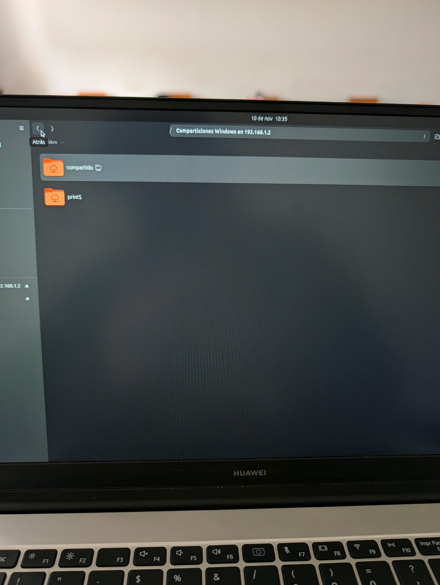
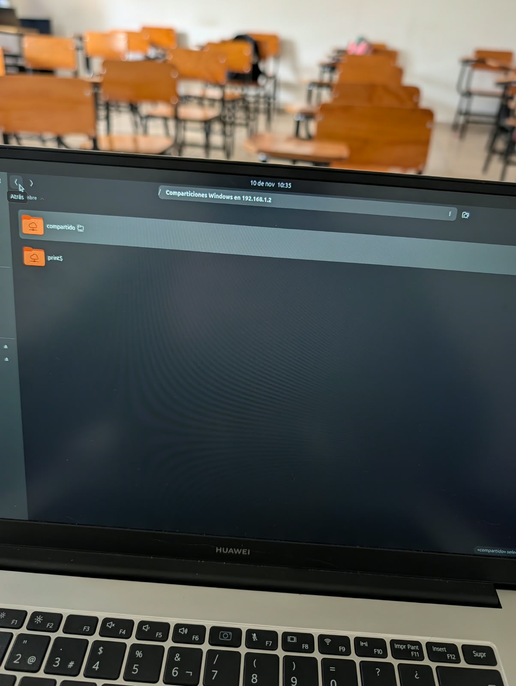
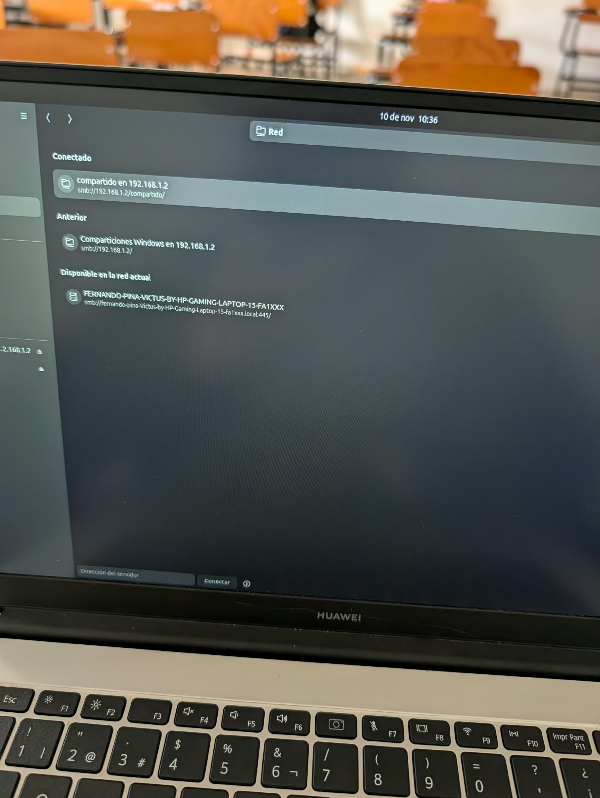

# 📌 Nombre del proyecto
**Compartir Archivos en Red Local (Ubuntu - Ubuntu)**

---

## 📖 Descripción
El objetivo de esta práctica es implementar un servidor de archivos en una red local utilizando el servicio Samba sobre Ubuntu Linux, y demostrar la conexión, lectura y escritura de archivos desde un segundo equipo cliente que también opera con el sistema operativo Ubuntu.

## 🎯 Objetivos de aprendizaje
Familiarizarse con la instalación y configuración de servicios de red en Linux. Aprender a definir recursos compartidos editando el archivo `/etc/samba/smb.conf`, gestionar los permisos de archivos y carpetas (`chown`, `chmod`), administrar contraseñas de red (`smbpasswd`) y acceder a los recursos de manera remota desde otra terminal Ubuntu utilizando herramientas de consola como `smbclient` o el explorador de archivos nativo.

## 💻 Material utilizado
- 💻 Máquina Servidor con el sistema operativo **Ubuntu Linux**
- 💻 Máquina Cliente con el sistema operativo **Ubuntu Linux**
- ⚙️ Servicio de red para compartir archivos (Samba) y terminal

---

## 📄 Informe
- 📎 [Informe](Informe/Informe_Ubuntu-Ubuntu.pdf) 

## 📸 Evidencias de la práctica
<table align="center">
  <tr>
    <td align="center">
       
      <i>1. Configuración del servidor Samba en Ubuntu</i>
    </td>
    <td align="center">
       
      <i>2. Verificación de permisos y estado del servicio</i>
    </td>
    <td align="center">
       
      <i>3. Conexión y transferencia exitosa desde el cliente Ubuntu</i>
    </td>
  </tr>
</table>

---

## 📝 Comandos
- ⌨️ [Comandos](Comandos/readme.md)

## 🎥 Video del funcionamiento
- 📄 [Readme](Vídeo/readme.txt)
- ▶️ [Ver video en YouTube](https://youtu.be/PON_TU_ENLACE_AQUI)

---

## 💡 Conclusiones
La práctica demostró exitosamente cómo establecer un entorno de compartición de archivos descentralizado entre dos máquinas Linux (Ubuntu-Ubuntu). Se corroboró la importancia de alinear los permisos del sistema de archivos local (`chmod 777` y `chown`) con los permisos lógicos del servicio de red en `smb.conf` para evitar errores de acceso. Acceder al servidor a través de la red local (usando la sintaxis `smb://<IP>/` o comandos de terminal) permitió validar que la información fluye de manera segura y bidireccional, facilitando el trabajo en red sin depender de medios de almacenamiento físicos.

## 📊 Resultados
- 📈 [Resultados](Resultados/Resultados_Ubuntu-Ubuntu.pdf)
