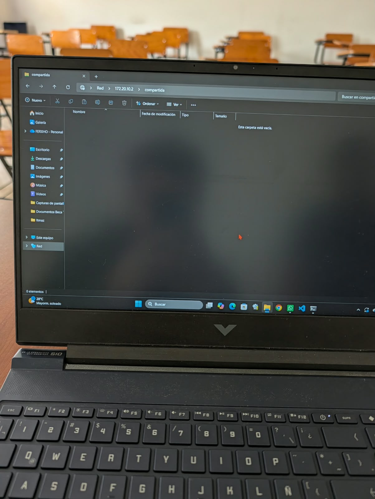
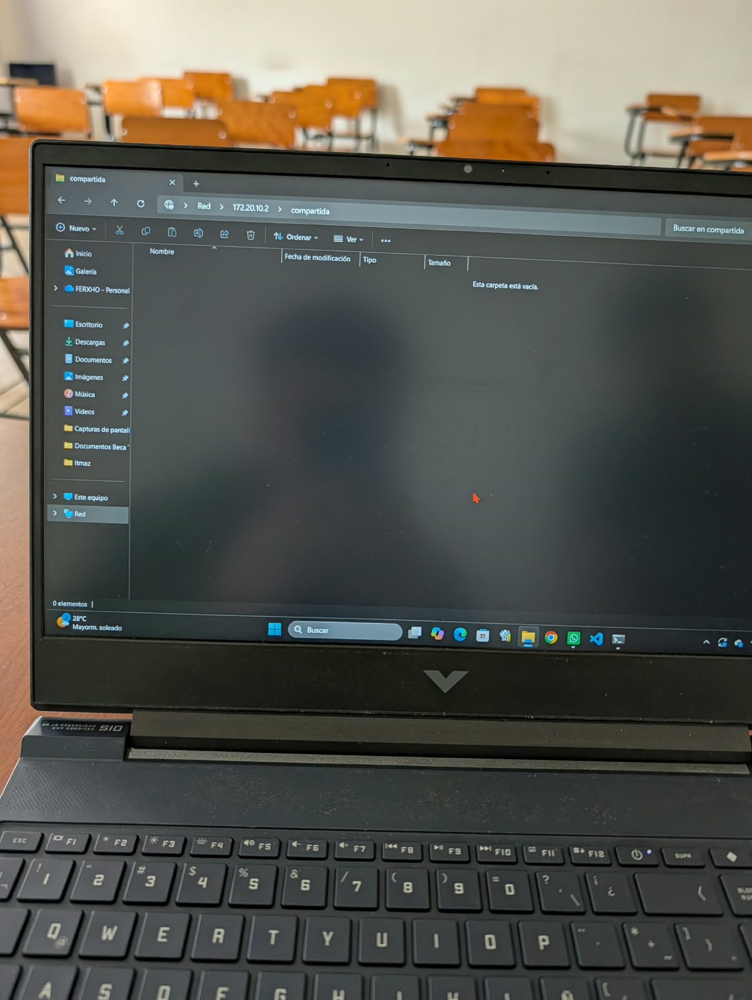
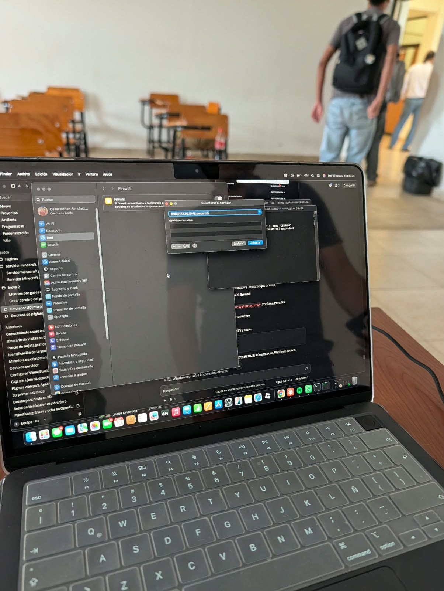
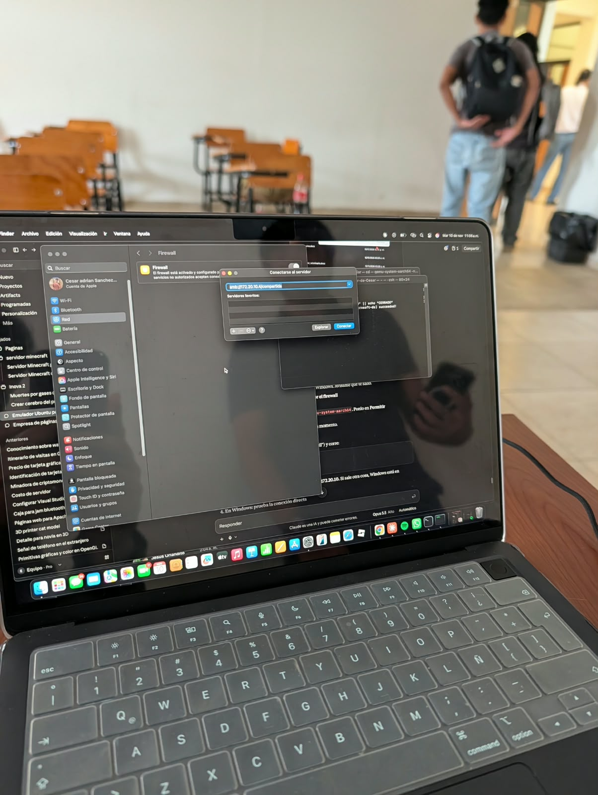

# 📌 Nombre del proyecto
**Compartir Archivos en Red Local (Ubuntu - Windows)**

---

## 📖 Descripción
El objetivo de esta práctica es implementar un servidor de archivos en una red local utilizando el servicio Samba sobre Ubuntu Linux, y demostrar la interoperabilidad de sistemas operativos al conectar, leer y escribir archivos desde un equipo cliente que opera con Windows.

## 🎯 Objetivos de aprendizaje
Familiarizarse con la configuración de servicios multiplataforma. Aprender a preparar un recurso compartido en Linux (gestionando `/etc/samba/smb.conf` y permisos con `chmod`/`chown`) para que sea compatible con el protocolo SMB/CIFS nativo de Microsoft. Del lado del cliente, aprender a mapear y acceder a unidades de red desde el Explorador de Archivos de Windows utilizando la sintaxis de rutas UNC (`\\IP_DEL_SERVIDOR\compartido`) y la autenticación de usuarios remotos.

## 💻 Material utilizado
- 💻 Máquina Servidor con el sistema operativo **Ubuntu Linux**
- 💻 Máquina Cliente con el sistema operativo **Windows 10/11**
- ⚙️ Servicio de red Samba y consola de PowerShell/Explorador de Windows

---

## 📄 Informe
- 📎 [Informe](Informe/Informe_Ubuntu-Windows.pdf) 

## 📸 Evidencias de la práctica
<table align="center">
  <tr>
    <td align="center">
       
      <i>1. Configuración del servidor Samba en Ubuntu</i>
    </td>
    <td align="center">
       
      <i>2. Asignación de permisos y reinicio del servicio</i>
    </td>
  </tr>
  <tr>
    <td align="center">
       
      <i>3. Acceso mediante la IP desde el Explorador de Windows</i>
    </td>
    <td align="center">
       
      <i>4. Transferencia de archivos exitosa entre sistemas</i>
    </td>
  </tr>
</table>

---

## 📝 Comandos
- ⌨️ [Comandos](Comandos/readme.md)

## 🎥 Video del funcionamiento
- 📄 [Readme](Vídeo/readme.txt)
- ▶️ [Ver video en YouTube](https://youtu.be/PON_TU_ENLACE_AQUI)

---

## 💡 Conclusiones
La práctica comprobó la alta compatibilidad e interoperabilidad entre sistemas operativos distintos (Linux y Windows) al utilizar protocolos estandarizados como SMB/CIFS. Se identificó la principal diferencia en el método de acceso: mientras que en Linux se utiliza la notación `smb://`, en Windows se requiere la ruta UNC con barras invertidas (`\\IP\carpeta`). Además, se demostró que el servidor Samba en Ubuntu es capaz de manejar perfectamente la autenticación solicitada por Windows, permitiendo un flujo de trabajo fluido para compartir y editar documentos en entornos de red híbridos.

## 📊 Resultados
- 📈 [Resultados](Resultados/Resultados_Ubuntu-Windows.pdf)
